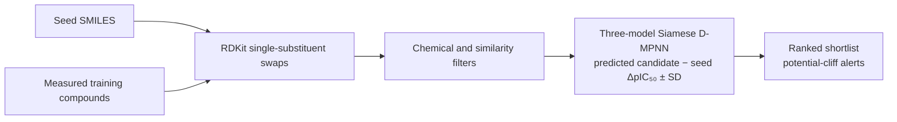

# CliffForge

**Relative-Affinity Molecular Analogue Prioritization and Activity-Cliff Analysis**

CliffForge is a research prototype for choosing which small change to a lead molecule to investigate next. An **activity cliff** is a pair of similar molecules with a large measured activity difference. Given a seed molecule, the implemented command-line workflow proposes close analogues, filters them, predicts their change in **pIC₅₀ assay activity** relative to the seed, and returns a ranked shortlist with a simple uncertainty signal. Higher pIC₅₀ means greater potency in this assay.

**TELEMEDICON26 · Team Genesis** — Chidwipak Kuppani (S20230010131) and Hrishikesh Kurapati (S20230010132).

> **Current scope:** a working, ligand-only 2D prototype and retrospective evaluations on SARS-CoV-2 main protease (Mpro). The measured endpoint is assay potency, **not** a direct binding-affinity measurement. CliffForge has not prospectively synthesized or assayed its ranked suggestions, and the current workflow does not dock them.

## What is implemented



1. **Generate:** apply single-substituent transformations observed at least twice in the training compounds. Each suggestion is traceable to its transformation precedent. This is rule-based RDKit generation; **it is not a neural** molecule generator.
2. **Filter:** reject invalid or duplicate structures and check parent similarity, edit size, PAINS, synthetic accessibility, allowed elements, and charge.
3. **Score:** encode the seed and candidate as 2D molecular graphs with shared-weight Siamese directed message-passing networks. A three-seed ensemble predicts candidate-minus-seed ΔpIC₅₀ and its standard deviation (SD).
4. **Rank:** sort by predicted ΔpIC₅₀ minus ensemble SD and flag close analogues with a large *predicted* change. Ensemble spread is an uncertainty signal, not a calibrated probability; a flag is not a confirmed activity cliff.

The research plan adds protein-pocket context, DiffSBDD analogue inpainting, validity re-checks and 3D pose checks for generated candidates, SMINA/GNINA/Vina scoring, and a pocket-aware Siamese encoder. Those protein-aware stages are **not implemented** in the current command-line prototype. The current model does not use protein coordinates, docking, or stereochemistry-aware 3D features.

## Statistically supported results

The table shows **only comparisons supported by the prespecified, six-comparison analysis** of the separate Dablander Mpro five-fold evaluation. It used molecule-level outer folds, paired cluster bootstrap with 5,000 resamples, and Bonferroni-adjusted intervals controlling familywise error at 0.05. The within-series outcome covers 2,014 local reference groups spanning 733 reference molecules. A positive interval throughout supports an advantage for CliffForge on that comparison.

| Retrospective outcome | CliffForge | Comparator | CliffForge − comparator | Familywise-adjusted interval |
|---|---:|---:|---:|---:|
| Mean within-series Spearman ρ, vs ChemProp | **0.509** | 0.343 | **+0.166** | **[+0.134, +0.197]** |
| Mean within-series Spearman ρ, vs similarity-weighted 5-NN | **0.509** | 0.287 | **+0.223** | **[+0.190, +0.254]** |
| Mean measured ΔpIC₅₀ among the top 10% of scored proposals, vs 5-NN | **1.116** | 0.824 | **+0.293** | **[+0.074, +0.508]** |

The ranking result is the clearest evidence for the model's intended **within-series prioritization** task. The top-10% comparison evaluates selection among supplied, experimentally measured pairs; it is not an assay of newly generated candidates. Adjusted superiority for **activity-cliff detection** or for **top-10% lead selection against ChemProp** was not established. See the [five-fold protocol](results/dablander_mmp_5fold/protocol.json), [exact results and intervals](results/dablander_mmp_5fold/performance_summary.json), and [full results interpretation](results/dablander_mmp_5fold/RESULTS_README.md).

## Data and evaluation scope

| Evaluation | Data and split | Activity-cliff rule | Role |
|---|---|---|---|
| [Original COVID Moonshot run](results/moonshot_mpro_tanimoto/) | 1,102 standardized 2D Mpro molecules; 961 train / 141 held-out test | Morgan Tanimoto ≥ 0.80 and measured \|ΔpIC₅₀\| ≥ 1.0 | Command-line generation, filtering, scoring, and initial evaluation |
| [Dablander matched-pair run](results/dablander_mmp_5fold/) | 1,924 Mpro molecules; 12,594 supplied matched pairs; five molecule-level outer folds | Measured \|ΔpIC₅₀\| ≥ 2 is a cliff; ≤ 1 is a noncliff; intermediate pairs are excluded from binary cliff detection | Larger, separate evaluation behind the supported comparisons above |

The datasets have different pair definitions and evaluation protocols; their cliff counts and rates should not be pooled. All results are retrospective on one target. In the original Moonshot strict held-out test, only five pairs meet the cliff definition, so that run does not establish reliable cliff detection. The full descriptive metrics remain available in [Moonshot results](results/moonshot_mpro_tanimoto/metrics/) and [Dablander results](results/dablander_mmp_5fold/).

## Install and run the command-line prototype

The pinned [requirements](requirements.txt) describe the original Python 3.9.25 / Linux CPU reference environment. [Data setup](data/README.md) and [model setup](models/README.md) give the provenance and expected files. Raw data and model weights are not committed to Git.

```bash
python -m venv .venv
source .venv/bin/activate
pip install -r requirements.txt

mkdir -p data/raw
curl -L -o data/raw/cdd_noncovalent_dates_2023_10_18_filt.csv \
  https://raw.githubusercontent.com/asapdiscovery/COVID_moonshot_data_clean/main/cdd_noncovalent_dates_2023_10_18_filt.csv
bash scripts/prepare_data.sh
bash scripts/train_relative_models.sh
bash scripts/run_demo.sh
```

The default demo chooses a held-out Moonshot seed and writes `outputs/demo/generated_candidates.csv`, `ranked_candidates.csv`, `shortlist.md`, and `funnel.json`. To supply a seed or inspect generation without model weights:

```bash
bash scripts/run_demo.sh --seed-smiles '<SMILES>' --seed-id mylig
bash scripts/run_demo.sh --no-score
```

The original Moonshot ChemProp comparator and evaluation can be run separately:

```bash
bash scripts/train_chemprop_baseline.sh
bash scripts/run_validation_cv.sh
bash scripts/run_evaluation.sh --with-cv
```

Use `--with-cv` after the validation run: the default reference-threshold lookup in `src/cliffforge/paths.py` still points to the former `results/metrics/` layout. These scripts reproduce the **Moonshot** workflow; they do not run the Dablander five-fold experiment. The latter uses [`scripts/CliffForge_Dablander_5Fold_Colab.ipynb`](scripts/CliffForge_Dablander_5Fold_Colab.ipynb), with settings and source hashes recorded under [`results/dablander_mmp_5fold/`](results/dablander_mmp_5fold/).

Set `CLIFFFORGE_DATA`, `CLIFFFORGE_MODELS`, or `CLIFFFORGE_OUTPUT` to change the default `data/`, `models/`, or `outputs/` directories. The frozen Moonshot reference files are in [`results/moonshot_mpro_tanimoto/`](results/moonshot_mpro_tanimoto/); new demo and evaluation outputs write to `outputs/`.

## Interpretation and next steps

- Predicted ΔpIC₅₀, docking scores, and binding affinity are different quantities. The current model predicts assay-activity differences; generated structures and cliff alerts are hypotheses for expert review.
- The next research stages are DiffSBDD analogue generation, structure-based scoring, stereochemistry and 3D-aware evaluation, broader held-out cliff validation, and experimental testing.
- The [11-slide presentation](presentation/TELEMEDICON26_CliffForge_Pitch.pdf) separates the proposed protein-aware pipeline from the implemented prototype. Its diagrams are editable in [`presentation/main.tex`](presentation/main.tex).

## Repository map

| Path | Purpose |
|---|---|
| [`src/cliffforge/`](src/cliffforge/) | RDKit generation, filters, Siamese model, command-line demo, and Moonshot evaluation |
| [`scripts/`](scripts/) | Data preparation, training, evaluation, validation, and Dablander Colab notebook |
| [`data/`](data/) / [`models/`](models/) | Setup instructions; downloaded data and trained weights stay local |
| [`results/`](results/) | Frozen Moonshot reference metrics and separate Dablander five-fold results |
| [`presentation/`](presentation/) | 11-slide Beamer/TikZ deck and speaker notes |
| [`tests/`](tests/) | Unit and regression tests; full discovery currently includes a legacy test importing a removed helper |

Code is MIT-licensed; source data and dependencies retain their respective licenses. For scientific background, see the [COVID Moonshot study](https://doi.org/10.1126/science.abo7201), [ChemProp paper](https://doi.org/10.1021/acs.jcim.9b00237), and [activity-cliff study associated with the Dablander data](https://doi.org/10.1186/s13321-023-00735-3).
