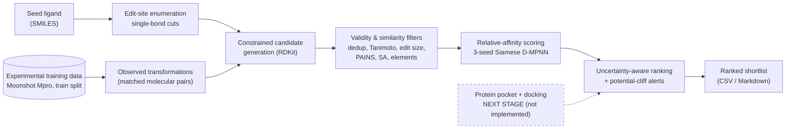

# CliffForge

**Relative-Affinity Molecular Analogue Prioritization and Activity-Cliff Analysis**

*A working proof-of-concept pipeline that proposes minimally edited analogues of a seed ligand, scores them with a Siamese relative-affinity model, and ranks them with uncertainty — built for early lead optimization.*

**TELEMEDICON26 hackathon submission · Team Genesis**

| | Name | Student ID | Programme |
|---|---|---|---|
| 1 | Chidwipak Kuppani | S20230010131 | UG4 |
| 2 | Hrishikesh Kurapati | S20230010132 | UG4 |

> **Status:** early-stage research prototype. The evidence below is retrospective, on COVID Moonshot SARS-CoV-2 main-protease (Mpro) data. No generated molecule has been synthesised, assayed or docked.

---

## Contents
1. [Overview and motivation](#1-overview-and-motivation) · 2. [Problem](#2-problem-being-addressed) · 3. [Approach](#3-proposed-approach-and-differentiators) · 4. [Workflow](#4-architectureworkflow) · 5. [Prototype features](#5-current-prototype-features) · 6. [Results](#6-quantitative-proof-of-concept-results)
7. [Install](#7-installation) · 8. [Data](#8-dataset-setup) · 9. [Weights](#9-model-weight-setup) · 10. [Demo](#10-demo) · 11. [Evaluation](#11-activity-cliff-evaluation-commands) · 12. [Outputs](#12-expected-outputs) · 13. [Reproducibility](#13-reproducibility-and-validation-protocol)
14. [Roadmap](#14-development-stage-and-next-milestones) · 15. [Ethics](#15-ethical-and-scientific-considerations) · 16. [References](#16-references-and-prior-research) · [Repository layout](#repository-layout)

---

## 1. Overview and motivation

During small-molecule **lead optimization**, medicinal chemists modify a promising compound hoping to improve potency. Most edits change activity only a little, but occasionally a tiny structural change shifts potency by an order of magnitude or more. Such pairs are called **activity cliffs** [(Stumpfe & Bajorath, 2012)](#16-references-and-prior-research). They are exactly where intuition and similarity-based reasoning are least reliable — and where good analogue prioritization saves the most synthesis and assay effort.

CliffForge turns an earlier research finding — *the training objective, not the molecular representation, governs how well a model ranks related analogues* — into an end-to-end workflow that proposes, filters, scores and ranks analogues of a seed ligand.

## 2. Problem being addressed

* **Close analogues are hard.** Global absolute-activity models can look accurate across a diverse dataset yet rank poorly *within* a chemical series. On the Mpro data a standard ChemProp model reaches a global Spearman correlation of about 0.78 but only **0.192** mean within-series (12 series).
* **Similarity is not enough.** Structurally similar molecules do not necessarily have similar potency — that is the definition of an activity cliff.
* **Blind generation is wasteful.** Unconstrained generators propose invalid, off-scaffold or irrelevant molecules; chemists need *small, traceable* edits around a known ligand.

## 3. Proposed approach and differentiators

**Seed ligand + experimental training data → observed transformation mining → constrained analogue generation → validity/similarity filtering → relative-activity scoring → potential activity-cliff alerts and a ranked shortlist.**

1. **Minimal, traceable edits.** Every candidate is one substituent swap that was *observed* in the training data (matched-molecular-pair transformation transfer with RDKit), with its precedent count and mean measured ΔpIC50 recorded. The generator is example-based and rule-driven — **it is not a neural generative model**.
2. **Relative-affinity learning.** A Siamese D-MPNN is trained on pIC50 *differences* between related molecules and predicts candidate-versus-seed activity directly (three-seed ensemble).
3. **Uncertainty-aware ranking and cliff alerts.** Ensemble spread is reported per candidate and used in the ranking score; a potential-cliff flag marks close analogues with a large predicted change.
4. **Honest, leakage-controlled evaluation.** Held-out compounds are masked at inference, thresholds are chosen on validation data only, and uncertainty is estimated with clustered resampling.
5. **Next stage (planned):** protein-pocket information and structure-based scoring (docking) — *not yet run*.

## 4. Architecture/workflow



Solid boxes are implemented and tested; the dashed box is the planned pocket-aware extension. Scoring is 2D (ligand graph only).

## 5. Current prototype features

* **Constrained analogue generation** from training-derived transformations (`cliffforge.generate`): sanitisation, deduplication, parent exclusion, Morgan-fingerprint similarity to the seed, exact edit-size bookkeeping (heavy atoms removed + added, kept separate from the net heavy-atom change), PAINS/SA/element/charge filters, and per-candidate traceability to its precedent.
* **Relative-affinity model** (`cliffforge.relmodel`, `networks`, `features`): whole-molecule Siamese D-MPNN, antisymmetrised pair prediction, three-seed ensemble, reference-anchored absolute estimates.
* **Activity-cliff evaluation** (`cliffforge.cliff_detection`, `cliffs`, `recall`, `cv`): strict held-out and lead-optimization settings, validation-selected thresholds, confusion matrices, precision/recall/F1, average precision, ROC-AUC, clustered bootstrap, matched-pair comparisons, a majority-class baseline and a non-learning 5-NN baseline.
* **Reproducible tooling**: data-preparation script that regenerates the curated table and split byte-for-byte, unit/regression tests, and a submission validator.

## 6. Quantitative proof-of-concept results

All numbers come from `results/` (reference run) and are re-checked by `scripts/validate_submission.py`. Dataset: COVID Moonshot non-covalent Mpro, **1,102 molecules** (961 train / 141 held-out test), pIC50 endpoint.

### 6.1 Relative-affinity learning improves within-series ranking

| Model | Mean within-series Spearman ρ (12 test series) |
|---|---|
| ChemProp absolute-activity baseline | 0.192 |
| **CliffForge relative-affinity model** (3-seed ensemble; single seeds 0.534 / 0.529 / 0.586) | **0.581** |

Paired Wilcoxon test across series: mean Δρ = +0.389, **p = 0.005**. This supports relative-affinity learning as a component of the workflow; it is a *ranking* result, not by itself evidence of better cliff detection.
*Prior internship research (previously reported, not new here):* on the FEP+ benchmark, relative-affinity training raised within-series Spearman from 0.386 to 0.644 across 26 series (p < 0.001), using five architectures with consistent direction.

### 6.2 Activity cliffs in the data

Definition (fixed in advance): Morgan (radius 2, 2048 bits) Tanimoto ≥ 0.80 **and** |ΔpIC50| ≥ 1.0 (a ten-fold potency difference).

| Pair partition | Cliffs found |
|---|---|
| All 1,102 molecules | **46** |
| – both members in the strict held-out test set | **5** (of 44 close held-out pairs) |
| – one held-out compound + one training reference (lead-optimization setting) | 14 (of 220 close pairs) |
| – both in training (used only for threshold validation) | 27 |

### 6.3 Preliminary activity-cliff detection signal (strict held-out pairs)

Initial held-out evaluation identified **two of the five** observed activity cliffs (2 of 5; no false-positive flag among the 44 close held-out pairs), versus **zero of five** (0 of 5) flagged by the ChemProp baseline; average precision 0.73 vs 0.35. A pair is flagged when |predicted ΔpIC50| ≥ τ: the relative model's validation-selected threshold is τ = 1.0 (same as the fixed reference), and ChemProp also flags 0 of 5 at its own validation-selected τ = 0.65 and at 1.0.

> This is a **preliminary signal from only five held-out positives**; the 95 % interval for the difference in average precision includes zero (−0.03 to +0.70). Expanded testing on larger datasets is the next validation milestone.

### 6.4 Lead-optimization setting (exploratory; mixed results)

Evaluating held-out compounds against measured training references (220 close pairs, 14 cliffs), a standard absolute-affinity baseline used as *predicted query minus measured reference* was competitive with, and on several direct metrics better than, the relative model (F1 0.52 vs 0.38 at τ = 1.0; average precision 0.57 vs 0.47; a simple similarity-weighted 5-NN baseline reached 0.60). Under our pre-declared decision rule this setting yields **"no demonstrated improvement over the baseline"**. We report it openly because it tells us where to focus next (larger positive sets, reference-aware modelling).

### 6.5 End-to-end analogue generation (reference seed: held-out Mpro compound, pIC50 7.18)

`324` attempted edits → `231` unique candidates → `34` pass chemical/structural filters → `34` scored; ≈ 27 s of CPU time in the reference run (37 s measured while packaging on a heavily shared machine). Predicted ΔpIC50 versus the seed spans −0.69 to +0.18 (model predictions, not measurements); no candidate is claimed to be more potent.

### 6.6 Retrospective generate-and-score check

The training-derived transformation library recovered **82 of 316** reachable held-out single-edit analogue pairs. On those recovered pairs the relative model predicted the correct activity direction in 53 of 82 (65 %), versus 47 of 82 (57 %) for ChemProp; the difference is not statistically significant (paired exact test p = 0.34). Supporting evidence of technical feasibility, not of superiority.

## 7. Installation

```bash
git clone https://github.com/chidwipak/TELEMEDICON26.git && cd TELEMEDICON26
python -m venv .venv && source .venv/bin/activate        # or a conda environment
pip install -r requirements.txt                          # tested: Python 3.9.25, CPU is sufficient
export PYTHONPATH="$PWD/src"                             # the scripts do this automatically
```

Tested versions: Python 3.9.25, RDKit 2022.09.5, PyTorch 1.12.1, PyTorch Geometric 2.3.1, ChemProp 1.6.1, NumPy 1.23.5, SciPy 1.9.3, pandas 1.5.3, scikit-learn 1.1.3. RDKit from conda-forge is recommended (`conda install -c conda-forge rdkit=2022.09.5`). Newer versions were not tested. Everything runs on CPU.

## 8. Dataset setup

No data is bundled. Download the public COVID Moonshot table (MIT-licensed `COVID_moonshot_data_clean`) and build the curated split — details, checksums and licensing in [`data/README.md`](data/README.md):

```bash
mkdir -p data/raw && curl -L -o data/raw/cdd_noncovalent_dates_2023_10_18_filt.csv \
  https://raw.githubusercontent.com/asapdiscovery/COVID_moonshot_data_clean/main/cdd_noncovalent_dates_2023_10_18_filt.csv
bash scripts/prepare_data.sh      # -> data/moonshot/{all,train,test}.csv  (1,102 molecules; 961 / 141)
```

## 9. Model-weight setup

**Weights are not bundled** (see [`models/README.md`](models/README.md) for exact filenames, hyper-parameters and SHA-256 of the reference checkpoints). Create them locally:

```bash
bash scripts/train_relative_models.sh       # models/rel_siamese_s{0,1,2}.pt   (~10 min per seed on CPU)
bash scripts/train_chemprop_baseline.sh     # models/chemprop_moonshot/        (baseline for the evaluations)
```

## 10. Demo

```bash
bash scripts/run_demo.sh                                    # reference demo -> outputs/demo/   (~30 s on CPU)
bash scripts/run_demo.sh --seed-smiles "<SMILES>" --seed-id mylig
bash scripts/run_demo.sh --no-score                         # generation + filters only (no weights needed)
```

## 11. Activity-cliff evaluation commands

```bash
bash scripts/run_evaluation.sh --fast       # ~3 min: ranking, cliff detection (200 resamples), generate->score check
bash scripts/run_evaluation.sh              # full 2,000 bootstrap resamples with the reference validation thresholds
bash scripts/run_validation_cv.sh           # optional: re-derive thresholds with 5-fold CV inside the train split
bash scripts/run_evaluation.sh --with-cv    # then evaluate with the freshly derived thresholds
```

## 12. Expected outputs

| Command | Writes | Reference |
|---|---|---|
| `run_demo.sh` | `outputs/demo/{generated_candidates,ranked_candidates}.csv`, `shortlist.md`, `funnel.json` | `results/metrics/` |
| `run_evaluation.sh` | `outputs/cliff_pairs/`, `outputs/cliff_detection/activity_cliff_detection_metrics.json` (+ per-pair CSVs), `outputs/recall/generation_recall.json` | `results/metrics/` |

The candidate table records parent and candidate SMILES, the exact transformation, similarity to the parent, `edit_size_heavy_atoms` (removed + added), `heavy_atom_delta` (net change), filter status/reason, the model-predicted ΔpIC50 with ensemble SD, score source and caveats. `results/figures/` holds the figures used in the slides.

## 13. Reproducibility and validation protocol

* **Split & definitions are fixed in advance:** the 961/141 within-series split is deterministic (`SEED = 17`); the primary cliff definition (Tanimoto ≥ 0.80, |ΔpIC50| ≥ 1.0) was declared before any model was evaluated; 0.70/0.60 similarity levels are sensitivity analyses only.
* **No leakage:** transformations and models use the train partition only; held-out activities are masked (NaN) in all inference paths and a finite-value assertion would fail if any were touched; cliff thresholds come from out-of-fold predictions of 5-fold CV *inside* the train split; true cliff labels are computed after predictions (`posthoc_*` columns).
* **Two settings, labelled correctly:** strict held-out pairs (both compounds unseen) and lead-optimization pairs (one unseen query + one measured training reference; exploratory).
* **Statistics:** pairs share molecules, so uncertainty uses cluster bootstrap (by connected pair components or by query molecule); model comparisons are paired; exact intervals are used for recall.
* **Packaging checks (run in this repository):** the data-preparation script regenerates the reference tables byte-for-byte; the packaged demo and detection evaluation reproduce the reference outputs (identical funnel and metrics); `python scripts/validate_submission.py` checks structure, secrets/paths hygiene, that README and slides agree with `results/`, the deck's page count, and the unit tests.

```bash
bash scripts/validate_submission.sh                  # full validation
python -m unittest discover -s tests -v              # unit tests (weight/data tests skip when resources are absent)
```

## 14. Development stage and next milestones

**Demonstrated so far:** a working generation → filtering → relative-scoring → ranking pipeline; improved within-series ranking on Mpro; a first held-out cliff-detection signal; reproducible, leakage-controlled evaluation tooling.

**Next development milestones**

1. **Expanded validation.** Evaluate activity-cliff detection on larger, series-rich datasets with many more held-out cliff pairs and pre-registered thresholds, and strengthen reference-aware modelling for the lead-optimization setting.
2. **Structure-based scoring.** Add a protein-pocket structure (e.g. Mpro) and a docking or other structure-based workflow; dock the seed and shortlist.
3. **Stereochemistry- and 3D-aware modelling** (the current data table and models are 2D and stereo-free).
4. **Richer generation.** Expand the transformation library and measure candidate coverage. *Engineering note:* in the reported runs, edits are substituent-for-substituent swaps; hydrogen-replacement edits are available behind an opt-in switch (`CLIFFFORGE_MATCH_H_SITES=1`, see `src/cliffforge/generate.py`) but were not part of the reported results.
5. **Experimental feedback.** Test a selected, model-prioritized candidate set when feasible.

## 15. Ethical and scientific considerations

* Outputs are **model-prioritized hypotheses** for expert review — not potency claims, not medical advice, and not a substitute for experimental testing.
* Predicted quantities (ΔpIC50, scores) are kept clearly separate from measured and benchmark-provided values throughout the code, tables and slides.
* The evidence is retrospective, from one target and a modest dataset; the strict held-out set contains five cliffs. We therefore describe results as *preliminary*.
* The Moonshot data are openly shared by the COVID Moonshot consortium; please cite the original work and respect its license. No patient data are used.
* Possible dual-use of molecular design tools is mitigated by the small, assay-anchored, example-based design of this prototype; it proposes close analogues of an existing ligand and is not a de-novo generator.

## 16. References and prior research

* **Prior internship research (basis of this work):** *Within-Series Binding Affinity Ranking Is Governed by the Training Objective, Not the Molecular Representation* (FEP+, COVID Moonshot, TNKS2, VEGFR2; five architectures). Quoted FEP+ and architecture results are previously reported there; the Mpro relative-affinity, cliff-detection, generation and retrospective results in this repository are new CliffForge experiments.
* Stumpfe, D.; Bajorath, J. *Exploring Activity Cliffs in Medicinal Chemistry.* J. Med. Chem. 55, 2932–2942 (2012). doi:10.1021/jm201706b
* Maggiora, G. M. *On Outliers and Activity Cliffs – Why QSAR Often Disappoints.* J. Chem. Inf. Model. 46, 1535 (2006). doi:10.1021/ci060117s
* van Tilborg, D.; Alenicheva, A.; Grisoni, F. *Exposing the Limitations of Molecular Machine Learning with Activity Cliffs.* J. Chem. Inf. Model. 62, 5938–5951 (2022). doi:10.1021/acs.jcim.2c01073
* The COVID Moonshot Consortium (Boby, M. L. et al.). *Open Science Discovery of Potent Noncovalent SARS-CoV-2 Main Protease Inhibitors.* Science 382, eabo7201 (2023). doi:10.1126/science.abo7201
* Yang, K. et al. *Analyzing Learned Molecular Representations for Property Prediction.* J. Chem. Inf. Model. 59, 3370–3388 (2019). doi:10.1021/acs.jcim.9b00237 (ChemProp / D-MPNN)
* Hussain, J.; Rea, C. *Computationally Efficient Algorithm to Identify Matched Molecular Pairs (MMPs) in Large Data Sets.* J. Chem. Inf. Model. 50, 339–348 (2010). doi:10.1021/ci900450m
* Ross, G. A. et al. *The Maximal and Current Accuracy of Rigorous Protein-Ligand Binding Free Energy Calculations.* Commun. Chem. 6, 222 (2023). doi:10.1038/s42004-023-01019-9 (FEP+ public benchmark)
* RDKit: open-source cheminformatics (<https://www.rdkit.org>); Paszke, A. et al. PyTorch (NeurIPS 2019); Fey, M.; Lenssen, J. E. PyTorch Geometric (2019).

---

## Repository layout

```text
TELEMEDICON26/
├── README.md · LICENSE · CITATION.cff · requirements.txt · .gitignore
├── src/cliffforge/      generate.py (analogue generation) · relmodel.py/networks.py/features.py/pairs.py (relative model)
│                        cliff_detection.py · cliffs.py · recall.py · cv.py (evaluation) · demo.py · data_prep.py · paths.py
├── scripts/             run_demo.sh · run_evaluation.sh · run_validation_cv.sh · prepare_data.sh · train_*.sh · validate_submission.{sh,py}
├── tests/               unit + regression tests (data/weight tests skip when resources are absent)
├── data/                README with download/setup instructions (no data committed)
├── models/              README with expected checkpoint names and settings (no weights committed)
├── examples/            reference seed ligand and usage
├── results/             frozen reference metrics (JSON/CSV), summary.json, figures
└── presentation/        six-slide Beamer/TikZ deck (main.tex, references.bib, compiled PDF, build.sh)
```

License: MIT (code). Third-party data and libraries retain their own licenses.
